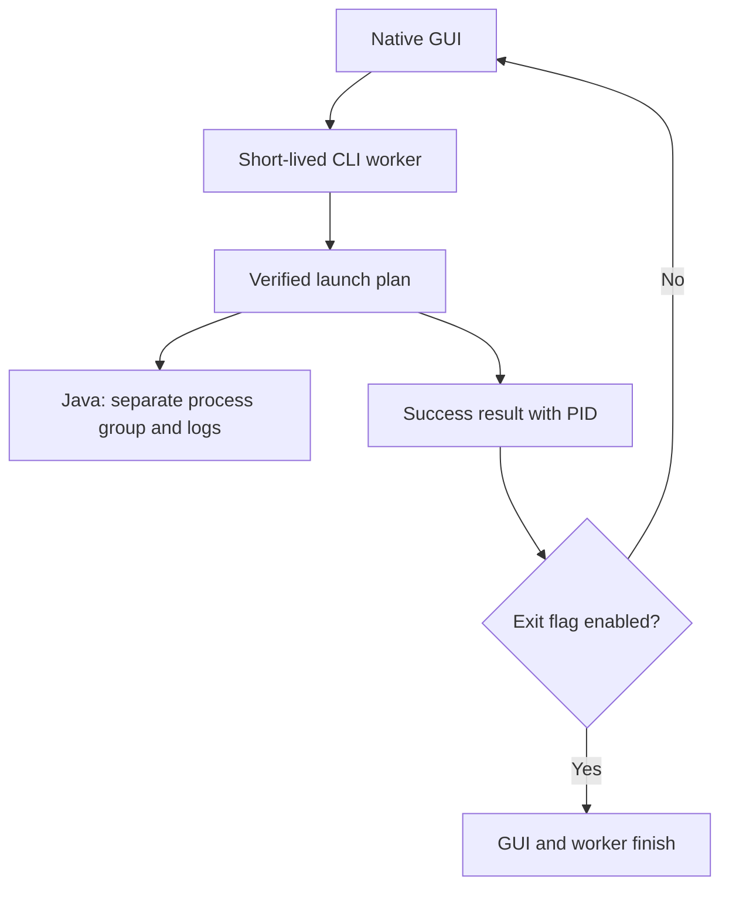

# Architecture and resource ownership

zmcl separates portable launch planning from operating-system work. The goal is to keep the launcher's own installation and process lifetime small while providing practical Minecraft workflows. The functionality target remains [XMCL v0.73.1 at a fixed commit](FEATURES.md); implemented commands, controlled tests and real game outcomes have separate acceptance records. [VALIDATION.md](VALIDATION.md) records functional evidence, and [PERFORMANCE.md](PERFORMANCE.md) records the measured process trees and storage populations.

## Project Z boundary

The portable [`zmcl-core` crate](../crates/zmcl-core/src/lib.rs) uses `no_std + alloc` and forbids unsafe Rust. It parses bounded JSON through Project Z `zconv`, represents Minecraft metadata and inheritance, evaluates rules, constructs download/launch plans and supplies incremental SHA-1, SHA-256 and MD5. Filesystem access, networking, process creation, native windows and credentials remain in the application. A core launch plan is an executable plus an argument vector; it is never a shell command.

The application uses Project Z `zclap` for command parsing and the unified `zgpui` package for the optional desktop frontend. Window creation, input, Canvas drawing and widgets call `zgpui::native`; the dependency enables `native` and `linux-software`. On Linux this renders on the CPU and submits pixels through X11, without a GL context or renderer worker. This is an actual backend integration. The core remains `no_std + alloc`; `zgpui` also retains its separate no_std scene API when native features are disabled. Other OS backend code does not imply native acceptance on those systems. Exact dependency versions and gitlinks are maintained in [Cargo.toml](../Cargo.toml), [Cargo.lock](../Cargo.lock) and [.gitmodules](../.gitmodules). Release settings use size optimization, LTO, one code-generation unit, aborting panics and stripped symbols.

| Component | Responsibility | Persistent ownership |
|---|---|---|
| [Core](../crates/zmcl-core/src/) | Bounded JSON, hashes, safe relative paths, manifests, rules, inheritance and argv plans | None |
| [Runtime](../src/runtime.rs) | Official metadata, loader profiles/installers, assets/natives, Java selection and game launch | Instance installation state and launch records |
| [Network](../src/net.rs) / [store](../src/store.rs) | Bounded HTTPS transfers, expected-digest checks and conventional Minecraft paths | Shared verified objects and metadata cache |
| [Java](../src/java.rs) | Adoptium runtime selection, verification, extraction and version check | Versioned managed JREs and selector records |
| [Content](../src/content.rs) | Modrinth mods, dependency resolution, mrpack and pack catalogue | Mod lock, import state and mod transaction journal |
| [Resources](../src/resources.rs) | Resource/shader ZIP lifecycle and recoverable revisions | Resource lock, journal and retained history |
| [Worlds](../src/worlds.rs) / [backup](../src/backup.rs) | Save metadata, safe file transfer and checksummed mutable-data snapshots | World directories, backup archives and restore state |
| [Instance lifecycle](../src/instance_manage.rs) | Independent writable clone and reversible trash/restore | Instance directories and trash records |
| [Servers](../src/server.rs) | Official Java server installation, explicit-EULA start, status/stop and TCP ping | Server configuration, logs and process identity |
| [Horizon](../src/horizon.rs) | Signed official launcher component as a separate provider | Versioned verified payload and provider data |
| [Accounts](../src/auth.rs) | Device authorization, token refresh and account selection | Public account metadata; tokens in an OS secret store |
| [GUI](../src/gui.rs) | Native views, bounded worker output, cancellation and optional exit | User choices and activity state while open |

## Process lifetime

The native GUI waits for input and worker events instead of maintaining a web runtime or a launcher service. A user operation starts a short-lived CLI worker. Its stdout/stderr are captured with limits, cancellation targets its own process group, and completion returns a bounded result to the interface. Archive, credential and verification helpers also run only for the operation that needs them.

A successful game launch redirects output to files, starts Java in a separate process group on the supported Unix path and returns its PID. The Java process therefore does not depend on the GUI worker's lifetime. The optional `gui --exit-after-launch` launch flag is disabled by default; enabling it exits the GUI only after an uncancelled launch operation returns success and valid JSON containing a positive PID. Normal operations, malformed results, cancellation and errors leave the interface available. The direct CLI's `--wait` mode deliberately keeps the calling process alive.

The [Linux lifecycle acceptance](measurements/2026-11-20-gui-exit-and-window.json) observed the GUI exit successfully while its real Java game process continued running independently. That run checked process lifetime and native window properties; it did not capture a game menu and is not a performance benchmark. Zero launcher residency means the participating launcher processes have exited. Java, a managed server, Horizon's own launcher/game processes and another independent zmcl session remain separate consumers and must be counted when reporting total machine usage.

## Data layout

The application chooses an OS-appropriate data root, with explicit `--root` and `ZMCL_HOME` overrides. The layout below is relative to that root; source code uses validated identifiers and confined joins before accessing it.

| Relative location | Contents and lifecycle |
|---|---|
| `instances/<id>/instance.json` | Version, loader, Java preference, memory and installation state |
| `instances/<id>/game/` | Writable Minecraft game directory, including saves, options and installed content |
| `instances/<id>/mods-lock.json` / `resources-lock.json` | Provider identities, versions, filenames and expected file digests for managed content |
| `instances/<id>/resources-history/<revision>/` | Retained originals and before/after resource-lock snapshots |
| `instances/<id>/` installation/logging files | Generated loader profile, native extraction, game logs and last-launch identity |
| `shared/objects/` | Digest-addressed verified file objects |
| `shared/versions/`, `shared/libraries/` and `shared/assets/` | Standard Minecraft paths backed by shared objects; logging configurations live under assets |
| `runtimes/<major>-<os>-<arch>/` | Immutable release/hash directories and the selected managed Java runtime |
| `backups/<id>/` | Retained ZIP snapshots with SHA-256 manifests |
| `servers/<id>/` | Server JSON, verified JAR, EULA/properties files, logs and owned-process record |
| `providers/horizon/installed/<id>/` | Verified provider installation manifest and extracted payload |
| `providers/horizon/` provider data | Horizon-owned persistent data, separate from Java instances |
| `trash/<token>/instance/` and `item.json` | Reversible instance removal and its identity |
| `accounts/`, `cache/` and `locks/` | Account metadata, bounded-operation cache/staging, and advisory lock files |

The shared store reduces duplicate immutable downloads. Successful materialization uses hard links where supported and a file copy where linking is unavailable. A hard link shares an inode, not an independent writable file, so objects are made read-only and file identity matters when measuring disk usage. Active resource/shader files are independent writable copies: editing one must not alter the verified cache. Instance cloning also copies writable game files instead of linking them.

Retained backups, resource revisions, trashed instances, old Java releases and provider payloads consume real storage. Staging can temporarily hold both old and new data. The project does not claim those bytes disappear after installation, and it has no general automatic history-retention policy. Storage reports must identify their dataset and distinguish logical path bytes from allocated bytes of distinct files.

## Installation and provider trust

The download layer receives a bounded destination, expected size where available and an expected digest. Provider metadata is obtained over HTTPS; bytes are checked before the store publishes them. Minecraft and Modrinth commonly use SHA-1, while managed Java uses SHA-256. A cached file must pass the same expected-value checks before reuse. Real acceptance includes corruption of both a conventional library path and its cache object, followed by successful redownload and restoration of verified shared materialization.

A Minecraft installation resolves the official version and inheritance, selects or provisions the required Java major, merges the loader profile and repeats the Java requirement check. The resulting plan determines libraries, client, natives, logging configuration and assets. Explicitly configured Java paths are checked and their errors are surfaced. Automatic Adoptium installation is available only when the instance has no explicit Java preference and no suitable discovered runtime. Direct `launch` selects an installed runtime and does not download one.

Managed Java installs into a new release/hash directory. The archive's SHA-256 and size are checked, bounded ZIP/tar extraction rejects escaping or unsafe entries, and `java -version` must report the requested major before publication. Valid internal tar links are handled under confinement checks. A selector switches future launches without replacing a runtime directory that a running game might still use. Linux acceptance covers explicit Java 21 installation and automatic Java 25 provisioning during a Minecraft 26.3 installation, followed by a [real Minecraft 26.3 main menu](validation/game-menus-2026-11-20.json). World play, Realms and multiplayer remain separate acceptance targets.

Horizon has a separate trust and compatibility boundary. Its provider verifies the GitHub release asset digest, the official signed `SHA256SUMS` manifest and hashes of extracted files. The signing key and message format are fixed to the [official release-signing source](https://github.com/horizon-rust/horizon/blob/41e53103f721966f902f9c793ba89ac51904e5ad/crates/horizon-release-sign/src/lib.rs); the helper uses system OpenSSL for Ed25519 verification. Managed files are checked again before launch, and the official launcher's self-update is disabled so it cannot replace the verified payload. The accepted Linux result is installation and `--version` execution of launcher 0.2.84. Account authorization, legitimate Minecraft preparation, actual Horizon gameplay and Java-mod compatibility are separate unaccepted paths.

## Locks, stopped-instance checks and recovery

The [operation lock](../src/util.rs) holds an open file with `File::try_lock`. The operating system releases the lock when the owning process exits; the filename can remain without representing a live lock. Per-instance operations serialize changes. Multi-instance operations acquire their locks consistently, and provider operations use their own named locks.

Mutation guards check recorded game identity and world session locks before changing instance data. Linux checks use the recorded PID and process start identity together with the expected game directory; a bare PID is insufficient because operating systems reuse PIDs. World copying/export also holds the world's OS session lock while reading, and rechecks file identities to detect a changing source. On platforms where a recorded launch cannot be established as stopped, the guard refuses instead of assuming the game exited. These are process/file coordination controls, not permission to modify a live world.

A pending content, backup or resource journal blocks unrelated installation, launch and instance/world mutations that could invalidate recovery. Recovery operates under the appropriate lock and handles its own journal, while conflicting operation journals remain a blocker. Ambiguous state or modified files are preserved for review. The modules use different publication boundaries because a mod-directory update, a resource ZIP change and a full game-data restore own different files.

| Operation | Publication and recovery boundary |
|---|---|
| Mod add/update/remove | Fresh files are downloaded and checked before the managed mods directory/lock transition. Version-2 journals record enough identity for conservative recovery. Legacy journals lacking that identity are refused and retained. Manual or unrecognized files are preserved. |
| Resource add/update/remove/toggle | A per-file journal records the intended transition. New files publish without overwriting a conflicting destination; old managed files and lock snapshots remain in a revision directory. |
| Resource restore | The selected revision must match the current expected after-state. Restoring creates a reverse transaction, preserving the current revision as recoverable history. Changed or ambiguous files stop the operation. |
| World import/clone/export | Confined private staging, bounded copy/extraction, source checks and exclusive final publication. Existing destinations are refused. The code does not rewrite world chunks. |
| Backup restore | Verify all snapshot bytes into staging, preserve excluded managed roots, create a pre-restore snapshot and journal the game-directory swap. A later create/restore can recover an interrupted swap conservatively. |
| Instance clone | Copy writable game files and managed-content lock metadata into a new instance. Mark it uninstalled so shared installation artifacts, profiles and natives are recreated by install. |
| Instance trash/restore | Move the complete instance into a retained trash container. Restore refuses an occupied target and preserves the recorded data. Shared cached objects remain available. |

The Modrinth resolver is intentionally bounded: at most 512 projects, dependency depth 32 and 32 rounds of exact-version pin propagation. Required-version conflicts, incompatible projects and unsupported required filename-only external dependencies produce errors. It does not implement exhaustive SAT/backtracking across arbitrary release combinations. Resource-pack/shader requirements are reported rather than silently installing additional projects or a shader engine.

Mrpack hash behavior differs by direction. Download/import recomputes SHA-1 and verifies size, while preserving supplied SHA-512 metadata. Export streams each file to recompute SHA-1 and SHA-512, checks the expected SHA-1/size and emits both fields. The reader accepts older inputs that omit SHA-512, so it is deliberately more permissive than the [current format's required fields](https://support.modrinth.com/en/articles/8802351-modrinth-modpack-format-mrpack).

## File formats and bounded work

World metadata reads selected fields from gzip-compressed Java `level.dat/Data`, including display name, last-played time, game mode and version. It does not expose seed/player-position data or offer an NBT/chunk editor. Import accepts a directory or ZIP with one identifiable world root; export preserves ordinary world bytes and excludes the active session-lock file. Corrupt metadata remains visible as an invalid entry rather than being presented as a valid world.

Archive helpers reject unsafe paths, collisions under portable path rules, unsupported links/special files and decompression beyond their budgets. JSON, metadata, helper output and directory traversal are bounded before or during allocation. Limits are deliberate product boundaries and can reject unusually large valid content; a limit error must not be reported as successful installation.

| Boundary | Representative current limit | Source |
|---|---|---|
| Core JSON | 32 MiB input, 1,048,576 tokens, 131,072 fields | [JSON helper](../crates/zmcl-core/src/json.rs) |
| Instance clone | 50,000 entries, 512 MiB per file, 4 GiB total, depth 32 | [Instance manager](../src/instance_manage.rs) |
| World transfer | 50,000 entries, 1 GiB per file, 16 GiB total | [World helper](../src/worlds/manage.py) |
| World NBT | 8 MiB compressed and 16 MiB decoded | [World helper](../src/worlds/manage.py) |
| Server-list response | 1 MiB packet and bounded VarInt, DNS/connect/read deadlines | [Server protocol](../src/server.rs) |

Local Java server start is separately guarded. Creating a server does not accept the Minecraft EULA: `eula=true` must already be explicitly present before start. Managed start/stop currently uses Linux procfs and pidfd identity checks, with the expected executable, command, working directory and start identity. Stop sends a bounded graceful termination only to the verified owned process; uncertain identity is an error. Portable installation and modern Java server-list ping do not imply portable managed process control. The [server CLI acceptance](validation/server-cli-2026-11-20.json) installed the official Minecraft 1.21.1 JAR, independently checked its SHA-1/size, queried status/list and observed an explicit refusal with unchanged `eula=false` and no server Java process. The [reproducible script](../scripts/test_server_cli.py) never accepts the EULA or requests an accepted live-server start. The ping tests use local fake TCP peers; they do not contact arbitrary external servers.

## Accounts and system dependencies

Microsoft authentication uses an explicitly configured registered application ID and the device authorization, Xbox/XSTS and Minecraft entitlement/profile flow. Refresh tokens belong in the OS credential store; a plaintext token file is not the fallback. Launch-plan output redacts credentials, and provider secrets are kept out of process arguments where the system helper interface allows it. Live licensed-account authorization and every platform's credential adapter still need their own acceptance result.

A small Rust dependency graph does not remove operating-system dependencies. The application uses the following capabilities on demand; their processes, libraries and installed bytes are part of honest resource accounting.

| Capability | Runtime dependency |
|---|---|
| Native GUI | Project Z native-window implementation, platform window libraries and OpenGL/driver stack; accepted on Linux X11/XWayland with a private Xvfb/software-driver setup |
| HTTPS download | System `curl` |
| Safe archive and metadata work | Python 3.8+ standard-library helpers for ZIP/tar, gzip/NBT handling and operation-specific validation; one actual-interpreter resolver handles Windows `py -3`/`python`/`python3`, Unix `python3`/`python`, or the literal `ZMCL_PYTHON` executable path. Helpers use isolated UTF-8 execution; only successful discovery is cached. |
| Horizon signature verification | System OpenSSL with Ed25519 support |
| Account secrets | OS credential services and their platform adapters |
| Minecraft Java | A compatible system or managed JRE; its memory is separate from launcher residency |
| Horizon | The verified upstream launcher and whatever legitimate game data/preparation it requires |

Windows and macOS source paths, archive mappings or generated argument plans are not equivalent to native execution acceptance. The current managed-server process boundary is Linux-only; uncertain game-stop identity on other platforms fails conservatively. The native GUI has no accepted native Wayland or hardware-driver result in this dataset. Exact platform and user-flow limits are maintained in [FEATURES.md](FEATURES.md).

## Evidence and remaining work

The current implementation is supported by bounded-core unit tests, operation-specific Rust/Python tests and named real provider/GUI/game workflows. [The resource CLI script](../src/resources/test_cli.py) exercises official small downloads, update/history/restore and manual-file/process protection in an isolated home. [The lifecycle CLI script](../scripts/test_lifecycle_cli.py) completed 21 commands against a fresh home containing synthetic NBT and opaque region bytes: world roundtrips, SHA-256 backup/restore with a retained pre-restore snapshot, independent instance cloning and reversible trash. Three protective refusals were expected. Those fixtures prove command and file boundaries; they do not prove that a real Minecraft world loads. Public-pack installation plus a launch dry run proves resolution and plan construction, not successful gameplay.

Architecture review follows five questions: whether each module supplies a concrete user operation, whether ownership and process boundaries are clear, whether claims have named evidence, whether missing platform/game outcomes remain visible, and whether failure leaves recoverable data. Those questions drive the open acceptance work: licensed-account flows, more real worlds and loaders, native Windows/macOS runs, resource/shader rendering, remote and collaborative services, and complete GUI coverage. Performance changes must use the matched protocol in [PERFORMANCE.md](PERFORMANCE.md), including helper/driver and retained-data costs.
